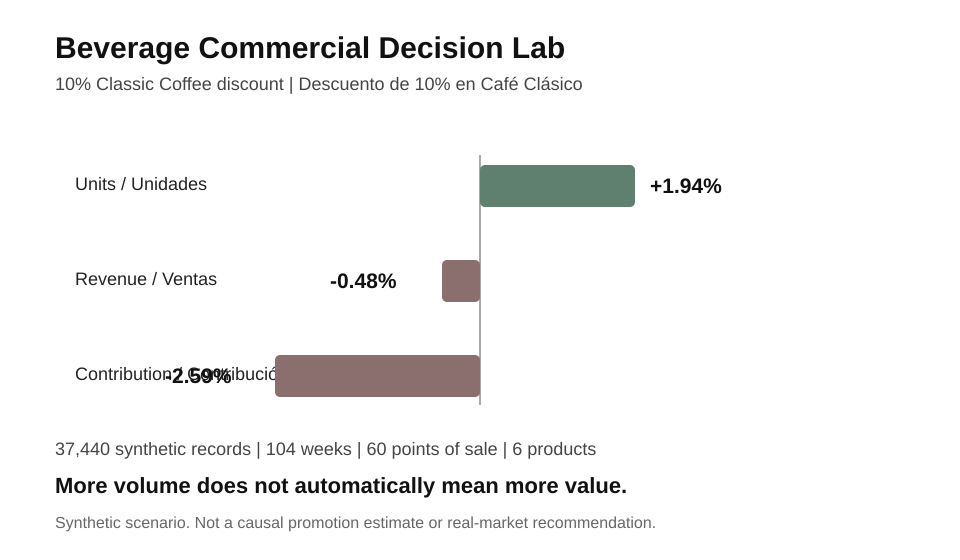

# Pricing and promotion commercial sample | Muestra comercial de precios y promociones

## English

**Supports:** U12 Pricing and promotions.

This sample uses a fully synthetic beverage business to show why a discount should be evaluated across volume, revenue and contribution at the same time. The model contains 37,440 weekly point-of-sale and product records across 104 weeks, 60 points of sale and six products.

In the reference scenario, a **10% discount on Classic Coffee** changes the six-product portfolio by **+1.94% in weekly unit volume**, **-0.48% in weekly revenue**, and **-2.59% in weekly contribution**.

**Example deliverable:** price scenario table, unit/revenue/contribution impact, sensitivity review, and concise interpretation of whether the simulated discount creates or destroys value under the stated assumptions.

**Main limit:** all data, costs and response assumptions are synthetic. Own-price elasticities are fitted to synthetic observations; cross-price elasticities and substitution relationships are assumptions. This is not a causal promotion estimate or a recommended real-market discount.

## Español

**Respalda:** U12 Precios y promociones.

Esta muestra utiliza un negocio de bebidas completamente sintético para mostrar por qué un descuento debe evaluarse al mismo tiempo en volumen, ventas y contribución. El modelo contiene 37,440 registros semanales por punto de venta y producto, 104 semanas, 60 puntos de venta y seis productos.

En el escenario de referencia, un **descuento de 10 % en Café Clásico** cambia el portafolio de seis productos en **+1.94 % de unidades semanales**, **-0.48 % de ventas semanales** y **-2.59 % de contribución semanal**.

**Ejemplo de entrega:** tabla de escenarios de precio, impacto en unidades/ventas/contribución, revisión de sensibilidad e interpretación breve de si el descuento simulado crea o destruye valor bajo los supuestos declarados.

**Límite principal:** todos los datos, costos y supuestos de respuesta son sintéticos. Las elasticidades propias se ajustan a observaciones sintéticas; las elasticidades cruzadas y relaciones de sustitución son supuestos. No es una estimación causal de promoción ni una recomendación de descuento para un mercado real.

Carlos Segura
